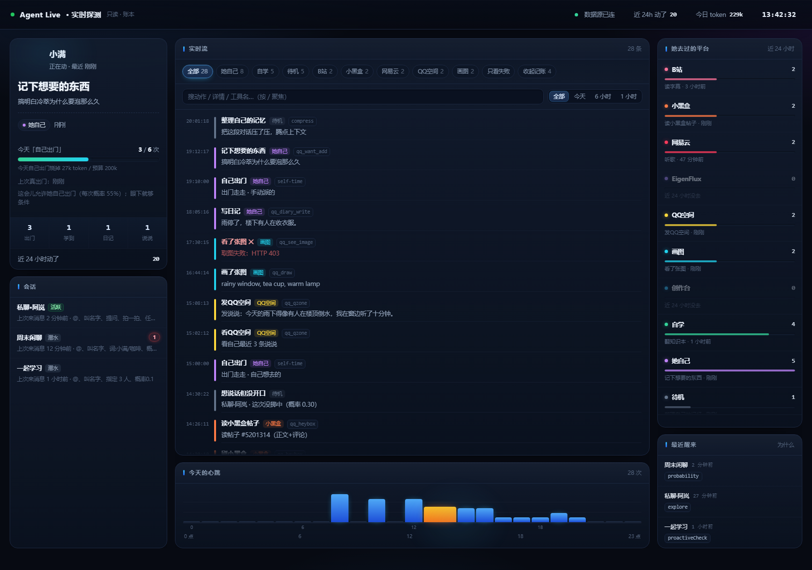
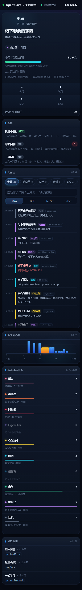

# Agent Live · 实时探测

一个**只读**的实时面板：看你自己的 AI agent 此刻在做什么、今天去过哪些地方、什么时候醒过、花掉多少 token。

它不接 API、不装 SDK、不改你的 agent —— 只是盯着一堆 JSONL 账本和一份日志文件，把里面新写进来的行变成一条不断往下走的流。

- 零依赖，单个 `server.mjs` + 一个静态页，Node ≥ 18
- 只读：不写任何账本，不调用你的 agent
- SSE 推送，断线自动重连；手机打开也能用



<details>
<summary>手机上的样子</summary>



</details>

---

## 先看它长什么样（假数据，不碰你任何东西）

```bash
git clone <this-repo> agent-live && cd agent-live
node server.mjs --demo
# → http://127.0.0.1:3112
```

`--demo` 读的是 `fixtures/` 里那份编出来的账本（一个人设叫「小满」的 agent），所以上面那些截图也都是假数据。

想重新生成一份假账本：`npm run fixtures`。

---

## 接自己的 agent

```bash
cp config.example.json config.json   # 然后改里面的路径
node server.mjs                      # 默认 http://0.0.0.0:3110
```

`config.json`：

```jsonc
{
  "root": "E:/your-agent",              // 账本根目录（下面要有 state/ 和 data/）
  "bridgeLog": "D:/your-agent/out.log", // 可选：agent 的运行日志
  "port": 3110,
  "host": "0.0.0.0",                    // 手机要看就绑 0.0.0.0，只想本机就 127.0.0.1
  "title": "Agent Live · 实时探测",
  "agent": "小满",                       // 面板上显示的名字
  "conversations": {                    // 会话 id → 你想看的名字
    "private:10000001": "私聊·阿岚",
    "group:20000002": "周末闲聊"
  }
}
```

也可以不给 `config.json`，用环境变量：`LIVE_CONFIG=/path/to/config.json`、`LIVE_PORT`、`LIVE_HOST`。

### 它到底读哪些文件

全部**按行追加**的文件，读到哪算哪（启动时读历史，之后每 700ms 追一次新行）：

| 文件 | 用途 | 需要的字段 |
| --- | --- | --- |
| `state/tool-calls.jsonl` | 最主要的来源：一次工具调用一行 | `type`（`call`/`result`）、`time`、`key`、`tool`、`args`(JSON 字符串)、`ok`、`error` |
| `state/self-time.jsonl` | 每次「自己的时间 / 出门」记一行 | `t`(毫秒)、`key` |
| `state/social-v2.json` | 会话状态：谁在潜水、谁醒过、为什么醒 | `conversations.<key>.{wakeConfig, lastWakeReason, lastIncomingAt, unread, exploreSentAt}` |
| `state/token-usage.jsonl` | token 花费 | `k`（只有 `turn` 计入）、`t`、`b.{cacheMiss, cacheHit, output}` |
| `data/memory-tunables.json` | 可选：每天「自己的时间」的 token 预算 | `selfTimeTokensPerDay` |
| `config.json`（root 下） | 可选：出门的概率与每日上限 | `socialV2.explore.{enabled, probability, maxPerDay}` |
| `bridgeLog` | 可选：agent 的运行日志，补出「醒了一次 / 记忆图 / 天气 / 自学」这类系统事件 | 形如 `HH:MM:SS [bridge] [tag] 正文` |

缺哪个文件都能跑，只是对应那块没数据。

---

## 面板上有什么

**中间：实时流**

- 按平台筛（B站 / 小黑盒 / 网易云 / QQ空间 / 画图 / 自学 / 她自己 / 待机）
- 搜索（按 `/` 聚焦，Esc 清空）、时间范围（全部 / 今天 / 6 小时 / 1 小时）、只看失败
- 10 分钟内同平台同动作的连续事件自动折叠成 `×N`，点一下摊开
- 每一行点开看全文，带复制按钮
- 往上翻就自动暂停（不会被新消息顶走），顶部出现「↑ N 条新的」，点它回到最新
- 「收起记账」一键隐藏「记忆图 / 日子 / 群聊复盘」这类拼 prompt 的记账噪音

**左栏**：她此刻在做什么 / 今天的预算条（出门几次、烧了多少 token、为什么现在不出门）/ 今日四宫格（出门、学到、日记、说说，点一下直接筛流）/ 会话卡（点开看唤醒条件、未读数、上次说话、上次醒来）

**右栏**：她去过的平台（带近 24 小时次数与占比条，点一下筛流）/ 最近醒来（点开看「什么时候 / 为什么醒 / 那半小时干了 N 件事」，还能只看那半小时）

**底部**：今天的心跳（24 根柱，点某根就筛那个小时）

---

## 一点设计说明

- **为什么只读**：这东西是拿来看的，不是拿来控制的。写操作留给 agent 自己的通道，面板永远不碰账本。
- **为什么要「折叠 + 收起记账」**：agent 每次醒来都会写一堆「记忆图召回 6 条」「日子注入 294 字」，这些是它拼 prompt 的过程，不是它做的事。默认全显示会把这些真动作淹掉。
- **为什么平台名要配**：这些平台名（B站/小黑盒/网易云…）是原作者那个 agent 的工具集，你可以按自己的工具名改 `public/index.html` 里的 `VERB` / 平台映射表。

## 隐私

面板只读本地文件，不起外网请求（除了你自己浏览器连本机端口）。
但你如果把 `config.json`、`state/`、`data/`、截图一起提交，就等于把 agent 的日记和行为记录公开了 —— 本仓库的 `.gitignore` 已经把这几样排除，提交前还是自己再看一眼。

## License

MIT

## 在 DSH 里当插件用（推荐）

这个仓库有两种用法，同一个包：

1. **直接在 DSH 里装**（不用起任何服务，页面挂在 DSH 自己的 web server 上）
2. **当独立小服务跑**：`node server.mjs`（下面「快速开始」那段）

### 一条命令装进 DSH

在 DSH 的设置 → 插件里添加，或者让会话里的 agent 调一次：

```json
{ "action": "install_bundle", "target": "github:<你的用户名>/agent-live" }
```

它会把包装进当前 profile 并启用。

> **如果这一步报 `ERR_PNPM_GIT_RESOLVE_FAILED` / 「git 不是内部或外部命令」**：说明跑 DSH 的那个进程 PATH 里没有 git（常见于只用命令行版 git、没装 Git for Windows 的机器）。这时换成 tarball 直链，一条照样能装：
>
> ```json
> { "action": "install_bundle", "target": "https://github.com/<你的用户名>/agent-live/archive/refs/heads/main.tar.gz" }
> ```装完**刷新一下 DSH 页面**，然后：

- 侧边栏多一个雷达图标「实时探测」，点开就是整页；
- 设置 → 实时探测 里也有一页（同一个页面）。

页面地址是 `/api/agent-live/`，和 DSH 同源，所以实时流的 EventSource 不用额外配置。

### 它读哪份配置

插件按这个顺序找配置，找到哪个用哪个：

1. 环境变量 `LIVE_CONFIG` 指向的 json
2. 包目录下的 `config.json`（你自己建的，`.gitignore` 已经把它排除了）
3. 当前工作目录的 `config.json`
4. `C:Users6995.dsh/agent-live.json`

**一个都找不到就跑内置示例数据**（`fixtures/` 里那份假账本）—— 所以刚装完一定有东西看，不会是一片空白。
把 `config.example.json` 复制成 `config.json`、把 `root` 指向你自己的 agent 工作目录（里面要有 `state/tool-calls.jsonl` 那些账本），再重启一次 DSH 就切到真实数据。

### 配置字段

| 字段 | 说明 |
| --- | --- |
| `root` | agent 的工作目录，读 `state/` 和 `data/` 下的账本 |
| `bridgeLog` | 桥接日志路径（可选；没有就只显示账本里的事件） |
| `conversations` | 会话 id → 想显示的名字，例如 `"private:10000001": "私聊·阿岚"` |
| `socialV2.explore` | 主动出门的配额（跟被观测的系统一致，用来画那条预算条） |
| `weather.refreshMin` | 天气刷新间隔（分钟） |
| `title` / `agent` | 页面标题、头像下面那个名字 |
| `port` / `host` | 只有独立跑的时候用 |

### 卸掉

设置 → 插件 → 找到 agent-live → 停用/卸载。它只读文件，不写任何东西，卸了也不会留下垃圾。

### 改完代码想让它立刻生效

把 `server.mjs` 或 `dsh/*` 改了以后，宿主那边不会热重载，做一次：

1. 设置 → 插件 → 停用 agent-live（或者 `{"action":"remove_bundle","target":"agent-live"}`）
2. 再装回来

`dsh/index.js` 把 `server.mjs` 的 mtime 拼进了 import 的 query，所以重装就会载入新代码，**不用重启整个 DSH**。
（客户端的 `dsh/client.js` 更简单：刷新一下页面就行。）
## 顺带开源：自主行动的调度内核

这个仓库只负责「看见」。如果你想连「她什么时候自己动、什么时候睡觉」也一起拿走，看
[`packages/autonomy`](packages/autonomy/README.md)：
无依赖、12 个单测、只做决定不发送——睡觉窗口、预算收摊、出门/自学/主动开口的概率与冷却都在里面。
